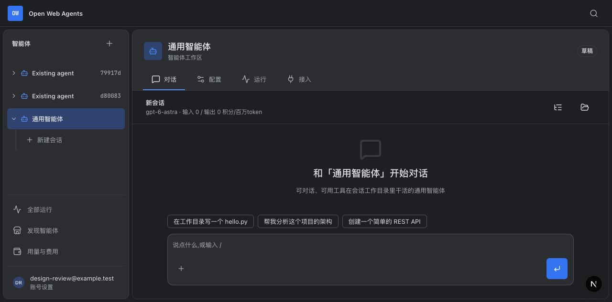
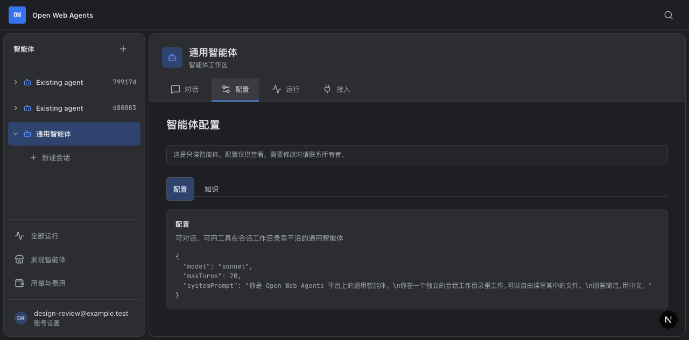
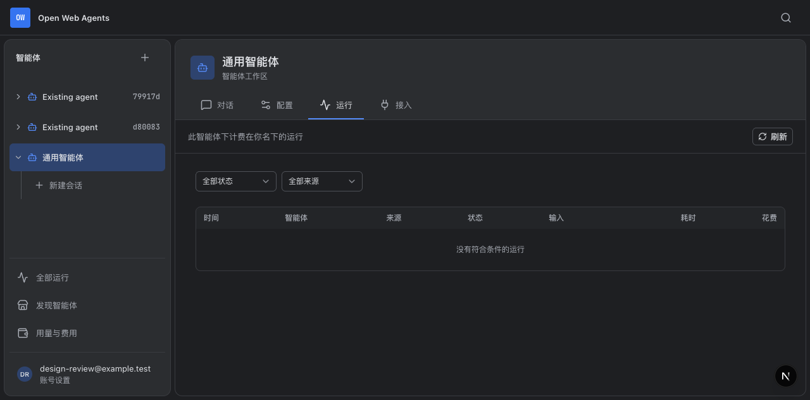
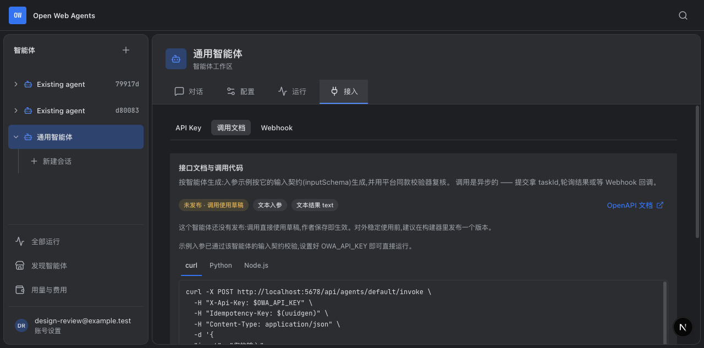
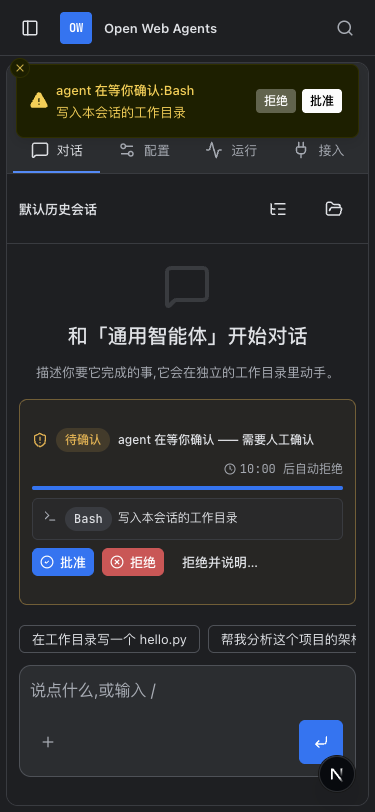

# B 对象工作区整体复盘

日期：2026-10-28。基准：`../dir-2.html` 与 `../direction-approved.md`。

本轮检查实际页面、对象与会话状态、异步请求生命周期、账号退出与缓存、审批、接入范围、错误恢复、移动端及可访问名称。保留已确认的 B 布局、圆角和功能归属，不重新选择设计方向。

## 发现与处理

| 级别 | 问题与影响 | 处理 | 证据 |
| --- | --- | --- | --- |
| P1 | 创建会话时离开工作台，迟到响应仍修改当前配置页 URL，并可能继续提交运行 | 卸载时使会话代次失效并中止本地请求；创建会话使用同一 AbortSignal，在更新 URL 前检查取消状态 | 修复前浏览器回归实际得到 `/agents?id=review-a&session=late-session`，修复后验证不改 URL、不提交运行 |
| P1 | 旧会话的追加消息请求迟到返回“需重发”，可能进入新会话的自动发送队列 | 追加响应绑定会话代次，切换时清理待确认集合；只允许原会话处理后续结果 | 拦截旧会话 steer 返回 409，验证新会话没有 run 请求、没有串入排队消息 |
| P1 | 登出或换账号后，旧身份请求仍能覆盖共享缓存 | 身份缓存增加请求代次；旧请求不能写缓存，也不能清理新的在途请求 | 两条单元测试在修复前均失败：旧用户回填缓存、旧用户覆盖新用户；修复后通过 |
| P2 | 删除、准备 AI 编辑、恢复版本的迟到回调可能清空新对象编辑器或跳回旧对象 | 将后续界面操作限定在原编辑代次；恢复版本期间新输入的修改保留，不直接覆盖 | 修复前删除 A 后 B 的 URL 退回 `/agents`；补充删除、AI 编辑、跨对象恢复及同对象继续编辑回归 |
| P2 | 登出接口失败仍提示成功；登出入口绕过未保存确认 | 仅成功响应后清理身份并跳转；失败保留页面并显示错误；登出前复用草稿确认，失败后确认仍有效 | 修复前 503 响应没有错误提示；修复后验证错误、页面、草稿保护均保留 |
| P2 | 审批轮询与通知没有完整绑定会话生命周期 | 审批组件按会话隔离；轮询丢弃过期响应；卸载后的审批操作不再更新通知与面板 | 验证迟到审批、切会话等待新审批时的旧内容清除 |
| P2 | 审批区沿用旧输入框的 144px 底部留白；常驻手机通知挡住对象树入口 | 移除旧留白、审批标题允许换行；手机通知位于顶栏下方并提供关闭入口，通知使用与工作区一致的暗色主题 | 浏览器实测通知拦截“打开智能体树”的点击；回归检查真实点击、输入区可见性、面板不重叠及无横向溢出 |
| P2 | 消息输入区附件按钮缺少可访问名称，提交按钮仍使用英文默认名称 | 为消息、附件、发送与停止提供中文可访问名称 | 浏览器可访问树与按角色查询验证 |

离开页面只中止本地请求和挂流，不隐式取消已经交给后台的运行。用户需要终止后台任务时仍使用明确的停止操作。

## 页面流程

以下为本轮新截图。前四步是独立审查账号的实际页面；第 5 步使用拦截接口构造待审批状态，不执行模型或工具。

1. **对话工作区：基本正常。** 对象标题、四页签和输入区层级清楚；本轮修复异步离开与补充消息的状态边界。

   

2. **配置：基本正常。** 只读配置和编辑权限区分清楚；异步删除、AI 编辑、版本恢复已加入对象边界保护。截图为只读通用智能体。

   

3. **运行：基本正常。** 对象页限定智能体，全局页仍允许独立筛选；失效对象链接不会回落到全量数据。

   

4. **接入：基本正常。** 文档契约跟随对象，账号 Key 绑定保持独立；未签发真实凭证或调用模型。

   

5. **手机审批：已修复后复验。** 审批按钮与输入区同时可见；常驻通知不再挡住顶栏的对象树入口，关闭通知不会撤销待审批。

   

## 保留的产品取舍

- 未发送文字、附件和排队消息的跨页面恢复规则：原型未定义，继续保留现有行为。
- 失效会话链接：目前清除失效 session 参数并回到新会话；是否改成错误页或恢复入口，需要明确产品规则。本轮不改变。
- 只读配置是否继续显示 JSON、知识与评测子表单是否统一纳入草稿恢复：涉及呈现与状态保留策略，不据个人偏好重做。
- 文档与实现的冲突：`AGENTS.md` 仍列出用户自带模型凭证、用户组管理；当前 `src/app/api/me/credentials/route.ts` 已返回 410，导航与分享界面按企业账号模型组织。这是既有差异，需统一产品口径后再更新文档或实现。

## 验证与限制

- 全量单元测试：1,891 通过，36 跳过。
- 浏览器回归：27 项通过，覆盖对象状态、审批、登出、权限入口、接入范围和移动端；新增 2 条身份缓存乱序单元回归。
- TypeScript、Biome、IDE 构建与 Git 空白检查通过。
- IDE 检查仍有局部捕获异常、兼容性 API 和测试重复片段等非阻断警告。
- MySQL/Redis 的部分契约测试因为没有专用测试地址而跳过或提前返回，不能据此声称完成真实数据库与 Redis 集成验收。
- 未运行真实付费模型、真实工具审批、生产任务或故障恢复演练；截图也不能证明完整屏幕阅读器兼容性。
- 所有变更保留在本地，未提交。

## 本轮涉及文件

- `src/features/workbench/workbench.tsx`
- `src/features/workbench/approval-bar.tsx`
- `src/features/builder/builder.tsx`
- `src/features/builder/design-workspace.tsx`
- `src/components/ide/client-navigation.ts`
- `src/components/user-menu.tsx`
- `src/components/ui/sonner.tsx`
- `src/lib/use-me.ts`
- `src/lib/__tests__/use-me.test.ts`
- `playwright/object-state-regressions.spec.ts`

可访问性实现参考了 `modern-web-guidance` 的 `accessibility` 指引：“Every interactive element and some landmarks need an accessible name”。附件按钮使用明确的 `aria-label`，保留原有悬浮提示；没有用提示文本代替可访问名称。
